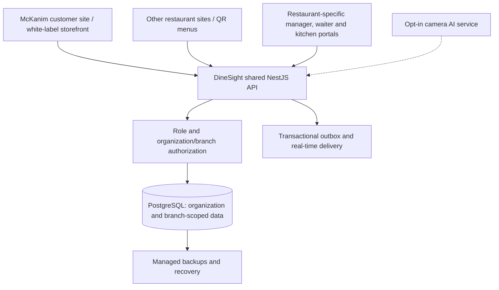

# DineSight multi-restaurant SaaS architecture
**Decision status:** Product-owner confirmed, 15 November 2026.
**System goal:** Retain DineSight intellectual property, license the hosted service to multiple independent restaurant customers, and use McKanim as the first pilot/reference brand.

## Architecture decision record ADR-001: shared application, scoped tenant data

### The identities are different
- **DineSight platform**: software product owned and maintained by the developer.
- **Organization / tenant**: paying restaurant business account. One organization may own multiple branches.
- **Restaurant / branch**: physical dining location with its own tables, staff assignments, menu, orders, cleaning and operational records.
- **Customer / guest**: table-scoped visit with no staff account.
- **Platform support administrator**: DineSight operator; NOT automatically permitted to view a customer's private orders or financial data.

The initial schema now adds `Organization` and a required `Restaurant.organizationId` foreign key. New organizations default to inactive until onboarding is approved. This is foundational **data modeling**, not complete isolation or customer access control.

### Recommended deployment

Start with one shared deployment and one PostgreSQL database, where `organizationId` identifies customer ownership and `restaurantId` identifies branch context. Avoid one NestJS server per customer unless enterprise needs justify the cost and operational overhead.

### Authorization requirements BEFORE any private endpoint ships
1. Authenticated identities carry server-verified organization membership and branch access; **never trust a request-supplied tenant ID**.
2. Every protected object lookup is scoped to the authorized organization and branch. Querying by a UUID alone must never authorize access.
3. An organization owner may access approved branches in their organization, subject to role permissions. Restaurant staff may access only assigned branches.
4. New restaurant, menu, table and order writes must verify that **every referenced record belongs to the same organization/restaurant** in the same transaction. SQL foreign keys on IDs alone do not guarantee this.
5. Support access to tenant data must be time-limited, auditable and explicitly justified/approved. Platform operators are not implicit restaurant employees.
6. Tenant boundaries and IDOR/BOLA defenses require both unit and API integration tests with **two independent organizations**. A successful test of a filtered SELECT is not security proof.
7. Evaluate PostgreSQL Row-Level Security as defense in depth **only** after the provider and runtime DB role support it. PostgreSQL table owners/superusers can bypass policies; use `FORCE ROW LEVEL SECURITY` where appropriate, a non-owner least-privilege runtime role, and transaction-local tenant context. Never declare RLS active merely because `organizationId` is present. See official documentation.

### Schema decisions
- `Organization`: account owner, lifecycle flags and branch collection.
- `Restaurant`: one branch under `organizationId`.
- `StaffUser`: currently scoped to a single branch as a temporary Phase 9A model. Future organization-level member identity and cross-branch roles must be specified in Phase 9B before authentication is shipped.
- `MenuItem`, `DiningTable`, `CustomerOrder`, `OutboxEvent`: branch-scoped; their relation constraints must be strengthened so cross-branch references cannot be inserted.
- Currency: integer `UGX` for the first Uganda pilot. Do not assume future international branches can use UGX without product changes.
- `Plan` and `Subscription` records: **not implemented**. Billing/entitlements should be added only when the trial, renewal, cancellation and access policy is approved.

### Commercial model
Recommend a **hosted subscription per organization**, with a base package plus branch-specific limits/add-ons. A separate annual/on-premise license can be negotiated if support, updates and code access are explicitly priced and documented. Camera analytics is an optional premium module with separate privacy review and hardware costs.

Do not hardcode guessed subscription prices. Validate operating costs (hosting, backup, support, transactions, SMS and cameras), expected tenant counts and margins with the first customer before setting UGX tiers.

### Data ownership and IP
DineSight software, underlying source code, architecture, shared improvements and platform trademarks should remain with the product owner under the contract. Restaurants retain ownership/control rights over their operational customer, menu, staff and transaction data to the extent provided by applicable law and contracts. Give them exports, retention schedules, access controls and termination procedures. Verify Uganda legal implications with qualified counsel.

### Stage gates
- [x] Product owner's multi-restaurant subscription/licensing decision documented
- [x] `Organization → Restaurant` schema boundary added
- [ ] SQL migrations reviewed, versioned and committed
- [ ] Tenant-scoped auth and membership implemented
- [ ] Cross-tenant write checks and composite foreign keys verified
- [ ] Dedicated application DB user and isolation tests with two tenants
- [ ] Plan limits and subscription lifecycle implemented after commercial approval
- [ ] First restaurant pilot passed and customer signs off

### Sources
- PostgreSQL row-level security: https://www.postgresql.org/docs/current/ddl-rowsecurity.html
- Prisma multi-tenant database design: https://www.prisma.io/postgres/multi-tenant-saas-database
- OWASP broken object-level authorization: https://api-security.owasp.org/editions/2023/en/0xa1-broken-object-level-authorization/
- Uganda Registration Services Bureau IP protection: https://ursb.go.ug/services/intellectual-property-registration/
