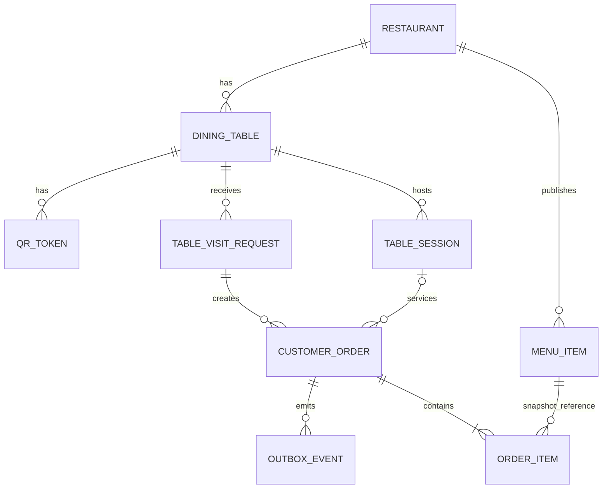

# DineSight ↔ McKanim — Phase 8 integration contract and backend handoff

**Status:** Draft design and executable client adapter only. 15 November 2026. No server, database, real checkout, or camera processing has been deployed in this phase.

## Scope and architecture decision

McKanim remains a standalone HTML/CSS/JavaScript **concept preview**. The upcoming DineSight service is a NestJS modular monolith backed by PostgreSQL and Prisma, with an independent vision service in a later release. This phase defines the common protocol, not an operational integration.

**Source of truth:** `contracts/dinesight-openapi.json` (OpenAPI 3.1.1).  
**Optional frontend adapter:** `integration/dinesight-client.js` (not referenced from `index.html`; never automatically sends orders).  
**Smoke tests:** `tests/dinesight-contract.test.cjs`, `tests/dinesight-client.test.cjs`.

## Customer order workflow (proposed)

1. Restaurant staff create a table in DineSight and print an **opaque table-specific QR URL**. Do not expose a sequential table ID as a security mechanism.
2. A customer opens the table URL and the website submits the QR token to `POST /api/v1/guest/table-access`.
3. The backend checks the current QR-token hash, expiry/revocation status and restaurant/table association, then creates a **pending table visit**. A QR scan is not proof of physical seating.
4. DineSight returns a short-lived guest-scoped token. The client may submit an **order request**. Orders are stored only as `PENDING_CONFIRMATION` and must not reach the kitchen yet.
5. The client submits `POST /api/v1/guest/orders` with the guest token, unique `Idempotency-Key` header and line items containing **menuItemId + quantity only**.
6. The backend validates available items and whole-shilling UGX prices, calculates totals using authoritative database prices, stores immutable item-name/price snapshots, and atomically records an outbox event.
7. The waiter verifies the customer/table and confirms the pending order. The backend validates the transition to `ACCEPTED`, links or creates the appropriate active table session, and then places it in the kitchen queue.
8. The chef changes `ACCEPTED → PREPARING → READY`; the waiter moves `READY → SERVED`. Other transitions must be explicitly validated server-side, with auditable cancellation rules.
9. Staff kitchen clients fetch `GET /api/v1/staff/kitchen/orders` on initial load and reconnection. Socket.IO can broadcast notifications later; REST state remains authoritative.

If the QR is copied and scanned off-premises, a malicious user might still create pending order requests. Enforce rate limits, anti-abuse controls and manual waiter confirmation. **Never** auto-release QR-initiated orders to the kitchen.

## API summary

| Actor | HTTP operation | Result |
|---|---|---|
| Public | GET /api/v1/public/restaurants/{restaurantSlug}/menu | Approved menu items with integer `priceUGX` |
| Guest | POST /api/v1/guest/table-access | Pending visit request and short-lived guest token |
| Guest | POST /api/v1/guest/orders | Pending order; unique idempotency key required |
| Guest | GET /api/v1/guest/orders/{orderId} | Only the guest's own order |
| Waiter/Manager | POST /api/v1/staff/orders/{orderId}/confirm | Confirm physically verified order |
| Chef/Waiter/Manager | GET /api/v1/staff/kitchen/orders | Authoritative kitchen queue |
| Staff (role-limited) | PATCH /api/v1/staff/orders/{orderId}/status | Validated status transition |

The API contract documents status codes and payloads, but the backend must still implement route-specific authorization. An API schema alone does **not** provide security.

## Money and consistency rules

- Currency fixed to `UGX` for the pilot; prices are **integer whole shillings** (no client-specified totals, no floats or USD conversions).
- Only approved menu records can be ordered; item availability and amount must be checked in the order transaction.
- `order_item` captures the purchased item name, quantity and unit price snapshot.
- The server owns taxes/service charges, with policy explicitly approved by the restaurant. No taxes are assumed in Phase 8.
- Duplicate POSTs using the **same idempotency key and same canonical request fingerprint** return the same order, without duplicate records. The same key with a different payload returns `409`.
- Every order transaction must commit the order, line items, idempotency record and outbox event together. Reconnecting kitchen clients re-fetch authoritative data.

## Data-model additions to implement later

Critical constraints: a unique table label per restaurant; one active table session per physical table; unique request idempotency per restaurant/scope; menu item identifiers and prices validated in the same transaction; all permissions scoped to the restaurant. In PostgreSQL, a **partial unique index** can enforce at most one active table session per table.

## Staff role authorization matrix (proposed)

| Action | Guest | Waiter | Chef | Manager |
|---|---|---|---|---|
| View public menu | Yes | Yes | Yes | Yes |
| Create pending own order | Scoped token | Manual order route later | No | Manual order route later |
| Confirm pending order / table | No | Yes | No | Yes |
| List kitchen queue | No | Read | Read | Read |
| Mark Preparing / Ready | No | No | Yes | Supervisor override only |
| Mark Served | No | Yes | No | Supervisor override only |
| Cancel order | No (request only, later) | Under policy | Under policy | Supervisor under policy |

The `x-roles` metadata in OpenAPI is descriptive; backend policies must implement this matrix.

## Initial backend implementation sequence

1. Create the NestJS project and PostgreSQL/Prisma connection (in a separate DineSight backend workspace or agreed monorepo).
2. Implement restaurant, tables, QR-token rotation, visit requests, menu and staff authentication.
3. Add request DTO validation, server-owned whole-UGX price calculations, idempotent order transaction and audit log.
4. Implement waiter confirmation and kitchen queue; enforce transitions and restaurant-scoped RBAC.
5. Add transactional outbox and Socket.IO updates **after** the REST flows pass; verify reconnect recovery.
6. Write integration tests covering duplicate requests, stale/revoked QR, incorrect restaurant/table, role escalation, price manipulation, unavailable items, and simultaneous order submissions.
7. Only then wire the McKanim UI to the backend behind an explicitly approved feature release and deploy a protected staging environment.

## Acceptance gate for moving beyond this phase

- [x] Machine-readable initial API contract added
- [x] Frontend adapter is opt-in and does not activate checkout
- [x] Contract tests prevent guest-supplied amounts and check role scoping
- [ ] Restaurant owner approves actual menu, tax/fee policy, table numbering and staff roles
- [ ] NestJS implementation and PostgreSQL migrations exist
- [ ] API contract tests run against a real server
- [ ] Order acceptance/kitchen workflow passes real end-to-end tests
- [ ] Secure staging and production deployment reviewed

## Decisions requiring the restaurant's confirmation

1. Is McKanim already an **operating restaurant** or a **proposed concept**?
2. How many dining tables and what table numbering scheme should be supported?
3. Does every guest QR order require waiter approval, or only the first order from a table? **Recommendation for pilot: every order.**
4. Are displayed UGX prices tax-inclusive, and is any service charge applied?
5. Will staff use a kitchen tablet/display or printed kitchen tickets?
6. Do staff use organization-managed accounts, and who may manage/approve their access?

## References

- OpenAPI 3.1.1: https://spec.openapis.org/oas/v3.1.1.html
- OWASP API1 Broken Object-Level Authorization: https://api-security.owasp.org/editions/2023/en/0xa1-broken-object-level-authorization/
- OWASP REST Security Cheat Sheet: https://cheatsheetseries.owasp.org/cheatsheets/REST_Security_Cheat_Sheet.html
- PostgreSQL CREATE INDEX / partial unique indexes: https://www.postgresql.org/docs/current/sql-createindex.html
